# Guide de présentation et de démonstration — Sentinelle

> Document destiné aux membres du groupe qui présentent le projet, et à toute personne qui découvre l'application.
> Il explique **ce qu'est le projet**, **comment il est construit**, puis déroule **une démonstration complète pas à pas** (≈ 20 minutes), avec les messages clés à faire passer et les réponses aux questions probables.

**Sommaire**

1. [Le projet en bref](#1-le-projet-en-bref)
2. [Architecture technique](#2-architecture-technique)
3. [Modèle de données](#3-modèle-de-données)
4. [Sécurité : rôles, habilitations, traçabilité](#4-sécurité--rôles-habilitations-traçabilité)
5. [Préparer la démonstration](#5-préparer-la-démonstration)
6. [Scénario de démonstration pas à pas](#6-scénario-de-démonstration-pas-à-pas)
7. [Plan B : incidents possibles](#7-plan-b--incidents-possibles)
8. [Questions probables et réponses](#8-questions-probables-et-réponses)
9. [Annexes](#9-annexes)

---

## 1. Le projet en bref

### Le besoin

Un service de renseignement reçoit des informations de sources très variées : presse, réseaux sociaux, registres publics (**OSINT**), contacts humains (**HUMINT**), imagerie (**IMINT**)… Ces informations sont souvent dispersées (fichiers, mails, notes), de fiabilité inégale, et leur exploitation pose trois problèmes :

- **Retrouver** une information et **relier** les éléments entre eux (qui connaît qui, qui était où, quand) ;
- **Évaluer** la valeur de chaque information (la source est-elle fiable ? l'information est-elle recoupée ?) ;
- **Protéger** l'accès : tout le monde ne doit pas tout voir, et chaque consultation doit être traçable.

### La réponse : Sentinelle

Sentinelle est une **application web** qui centralise le cycle du renseignement, depuis le schéma conceptuel de base de données fourni ([IMAGE_BD.jpeg](../IMAGE_BD.jpeg)) :

| Étape du cycle | Dans l'application |
|---|---|
| **Collecte** | Sources cotées, opérations de collecte, saisie d'informations, dépôt de documents |
| **Traitement / évaluation** | Cotation OTAN (source A–F × information 1–6), statut *brut → validé → archivé*, tags |
| **Analyse** | Dossiers d'entités, liens entre entités, réseau relationnel, carte, chronologie |
| **Diffusion / exploitation** | Recherche multicritères, tableau de bord, exports CSV et PDF |
| **Sécurité** | Rôles, niveau d'habilitation, journal d'audit |

### Le scénario des données de démonstration

Toutes les données sont **fictives**. Elles racontent une « affaire » cohérente pour rendre la démo vivante :

> Le **Groupe Orion** (société écran à Port-Louis, dirigée par *Andry Ramanantsoa*) contrôle le transitaire **Kestrel Logistique** au port de **Toamasina**. Des anomalies douanières, des coupures de signal du navire **MV Ndege Star** et des virements suspects vers l'**Association Vega** (Marseille) via **Sirocco Trading** (Dubaï) laissent penser à un réseau de trafic maritime et de financement. Une **escale critique** du navire est annoncée dans les prochains jours.

Contenu : 18 informations (dont 6 à valider), 14 entités, 17 liens, 16 événements, 10 lieux, 8 sources, 12 collectes, 10 tags, 5 utilisateurs.

---

## 2. Architecture technique

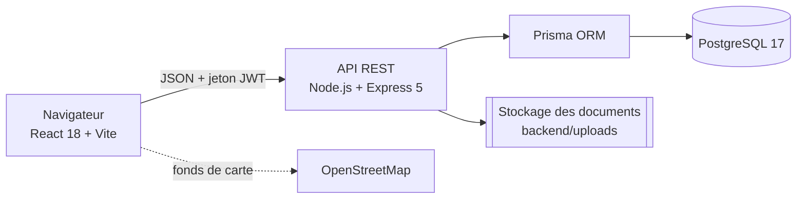

| Couche | Choix | Pourquoi |
|---|---|---|
| Base de données | **PostgreSQL** | SGBD relationnel robuste, intégrité référentielle, transactions, recherche insensible à la casse |
| ORM | **Prisma** | Schéma lisible ([schema.prisma](../backend/prisma/schema.prisma)), **migrations versionnées**, requêtes typées et paramétrées (protection contre l'injection SQL) |
| API | **Express 5** | Simple, standard, une route par table + routes d'analyse |
| Interface | **React + Vite** | Application monopage rapide ; Leaflet (carte), vis-network (graphe), Chart.js (graphiques) |
| Sécurité | **bcrypt**, **JWT**, **Helmet**, limitation des tentatives | Mots de passe hachés, sessions signées, en-têtes HTTP sécurisés |

**Base de données sans installation.** En plus d'un PostgreSQL classique, le projet peut lancer un **PostgreSQL portable** (paquet `embedded-postgres`) : c'est une vraie instance PostgreSQL 17, téléchargée par npm et démarrée automatiquement. C'est ce qu'utilise `npm run demo`.

**Organisation du code** : voir la section *Structure du projet* du [README](../README.md).

---

## 3. Modèle de données

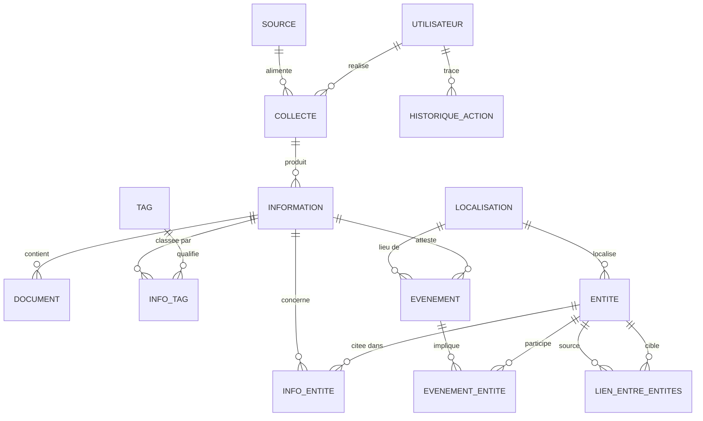

### Les tables

| Table | Rôle | Champs remarquables |
|---|---|---|
| `source` | Origine d'une information | `type_source` (OSINT, HUMINT…), `fiabilite_source` **A à F** |
| `collecte` | Une opération de recueil auprès d'une source | `methode`, `date_collecte`, `collecte_par` |
| `information` | L'unité de renseignement | `fiabilite_contenu` **1 à 6**, `niveau_classification` **1 à 4**, `statut` |
| `entite` | Personne, organisation, lieu, véhicule | `type_entite`, `alias`, `autres_attributs` (JSON libre) |
| `lien_entre_entites` | Relation orientée entre deux entités | `type_lien`, période, `fiabilite` |
| `localisation` | Lieu géoréférencé | `latitude`, `longitude` |
| `evenement` | Fait daté et localisé | `date_debut/fin`, `impact`, `id_info` |
| `document` | Fichier joint à une information | `hash` **SHA-256** (intégrité) |
| `tag` / `info_tag` | Mots-clés | — |
| `utilisateur` | Compte | `role`, `niveau_habilitation`, `mot_de_passe_hash` |
| `historique_action` | Journal d'audit | `action`, `table_concernee`, `id_enregistrement`, IP |

### Choix de conception à expliquer

- **Deux tables d'association ajoutées** au schéma initial : `info_entite` (une information concerne plusieurs entités, avec le **rôle** de chacune) et `evenement_entite` (entités impliquées dans un événement). Le schéma conceptuel indiquait ces relations N–N sans table pour les porter.
- **Cotation OTAN (« grille de l'Amirauté »)** : chaque information affiche un code comme **B2** = source *habituellement fiable* (B) × information *probable* (2). C'est la norme utilisée par les services de renseignement.
- **Classification à 4 niveaux** : Non protégé, Diffusion restreinte, Confidentiel, Secret, comparée au niveau d'habilitation de l'utilisateur.
- **Intégrité référentielle** : on ne peut pas supprimer une source qui a encore des collectes (refus explicite) ; supprimer une information supprime ses documents et rattachements.
- **Encodage UTF-8 forcé** à la création de la base (sous Windows, PostgreSQL utilise sinon WIN1252 et casse les accents).

---

## 4. Sécurité : rôles, habilitations, traçabilité

### Cinq rôles (schéma : « Utilisateurs selon habilitation »)

| Rôle | Mission | Peut… |
|---|---|---|
| **Opérateur terrain** | Remonter l'information | Saisir sources, collectes, informations, documents (statut *brut* uniquement) |
| **Analyste** | Exploiter | + créer et modifier entités, liens, lieux, événements, tags ; exporter |
| **Responsable** | Valider | + **valider / archiver**, supprimer, consulter le journal d'audit |
| **Décideur** | Décider | Tout consulter (selon habilitation), tableaux de bord, exports — **lecture seule** |
| **Administrateur** | Administrer | Tout, + gestion des comptes |

### Trois niveaux de protection

1. **Rôle** → ce qu'on a le droit de *faire* (matrice unique : [permissions.js](../backend/src/permissions.js)).
2. **Habilitation** → ce qu'on a le droit de *voir* : une information *Confidentiel* est invisible pour un utilisateur habilité *Diffusion restreinte*, **y compris** ses documents, ses événements et dans les exports.
3. **Traçabilité** → chaque connexion (réussie ou non), consultation, création, modification, suppression, export et téléchargement est inscrit dans `historique_action`.

> **Message clé :** ces contrôles sont faits **côté serveur**. Masquer un bouton dans l'interface ne suffit pas : même en appelant directement l'API, un opérateur ne peut ni lire une information *Confidentiel* ni valider une information.

---

## 5. Préparer la démonstration

### La veille

- [ ] Node.js 18.18+ installé (`node -v`).
- [ ] Récupérer le projet : `git clone …` puis `cd` dans le dossier.
- [ ] Lancer une première fois **`npm run demo`** (installe les dépendances et PostgreSQL portable : prévoir quelques minutes et une connexion Internet).
- [ ] Vérifier la connexion avec chaque compte, puis `Ctrl + C`.
- [ ] Relire la section 6 et se répartir les rôles de présentation dans le groupe.

### Le jour J (10 minutes avant)

- [ ] **`npm run demo -- --reset`** → données neuves, le navigateur s'ouvre sur <http://localhost:4000>.
- [ ] Connexion Internet active (nécessaire **uniquement** pour les fonds de carte).
- [ ] Zoom du navigateur à 100–110 %, mode plein écran (`F11`), notifications coupées.
- [ ] Ouvrir **deux onglets** avec `Ctrl + T` (pas « Dupliquer l'onglet ») : chaque onglet a sa **propre session** → onglet 1 = *Responsable*, onglet 2 = *Opérateur terrain*. Pratique pour changer de rôle sans se déconnecter.
- [ ] Garder ce guide ouvert sur un second écran ou imprimé.

### Comptes (mot de passe commun : `Demo2026!pass`)

Sur la page de connexion, cliquer sur un **profil** remplit l'adresse e-mail et place le curseur dans le champ mot de passe. Le mot de passe n'est **jamais affiché ni prérempli** : il faut le saisir à la main.

| Compte | Rôle | Habilitation | Voit |
|---|---|---|---|
| `admin@projet.local` | Administrateur | Secret | 18 informations |
| `responsable@projet.local` | Responsable | Secret | 18 informations |
| `analyste@projet.local` | Analyste | Confidentiel | 17 informations |
| `decideur@projet.local` | Décideur | Confidentiel | 17 informations |
| `operateur@projet.local` | Opérateur terrain | Diffusion restreinte | 12 informations |

---

## 6. Scénario de démonstration pas à pas

Durée totale ≈ **20 minutes**. Chaque acte indique **quoi faire**, **ce qu'on doit voir** et **le message à faire passer**.

| Acte | Thème | Compte | Durée |
|---|---|---|---|
| 0 | Introduction et connexion | — | 1 min |
| 1 | Tableau de bord | Responsable | 2 min |
| 2 | Saisie terrain | Opérateur | 3 min |
| 3 | Validation et cotation | Responsable | 2 min |
| 4 | Recherche multicritères et export | Responsable | 2 min |
| 5 | Dossier d'entité | Responsable | 2 min |
| 6 | Réseau relationnel | Responsable | 2 min |
| 7 | Cartographie et chronologie | Responsable | 2 min |
| 8 | Cloisonnement par habilitation | Analyste / Responsable | 2 min |
| 9 | Traçabilité et administration | Responsable / Admin | 2 min |
| 10 | Ergonomie et conclusion | — | 1 min |

---

### Acte 0 — Introduction et connexion (1 min)

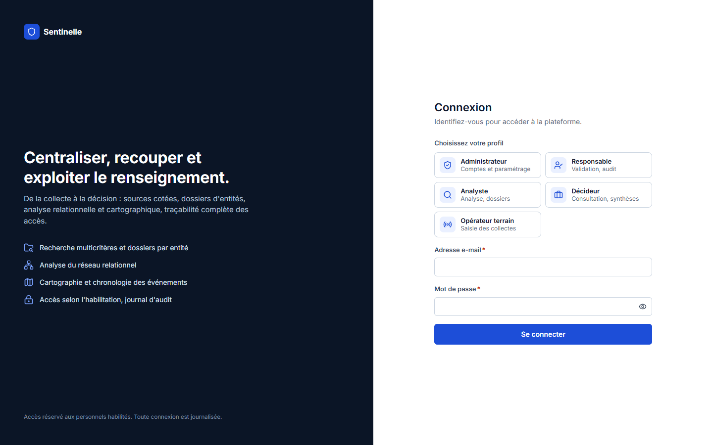

**À dire :** « Sentinelle centralise le cycle du renseignement : collecte, évaluation, analyse, diffusion. Nous allons suivre une affaire fictive, l'affaire *Orion*, avec plusieurs profils d'utilisateurs. »

**Faire :** dans l'onglet 1, cliquer sur le profil **Responsable**, saisir le mot de passe `Demo2026!pass`, puis **Se connecter**.

**À souligner :** l'accès est réservé et **toute connexion est journalisée**, même les échecs.

---

### Acte 1 — Tableau de bord (2 min)

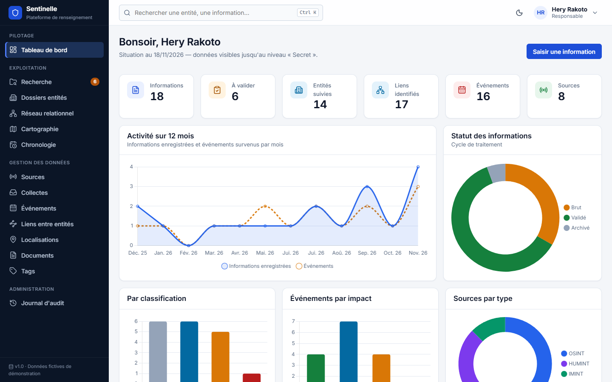

**Ce qu'on voit :**

- 6 indicateurs cliquables : 18 informations, **6 à valider**, 14 entités, 17 liens, 16 événements, 8 sources ;
- l'activité sur 12 mois (informations enregistrées et événements) ;
- la répartition par statut, classification, impact, type de source ;
- les dernières informations, les événements récents, les **entités clés** (les plus connectées).

**À dire :** « Le responsable voit d'un coup d'œil la charge de travail — ici 6 informations brutes attendent une validation, signalées aussi par le badge orange dans le menu — et les entités au cœur de l'affaire : Kestrel Logistique et le Groupe Orion. »

**À souligner :** le sous-titre rappelle le niveau de données visible (« jusqu'au niveau Secret »).

---

### Acte 2 — Saisie terrain par l'opérateur (3 min)

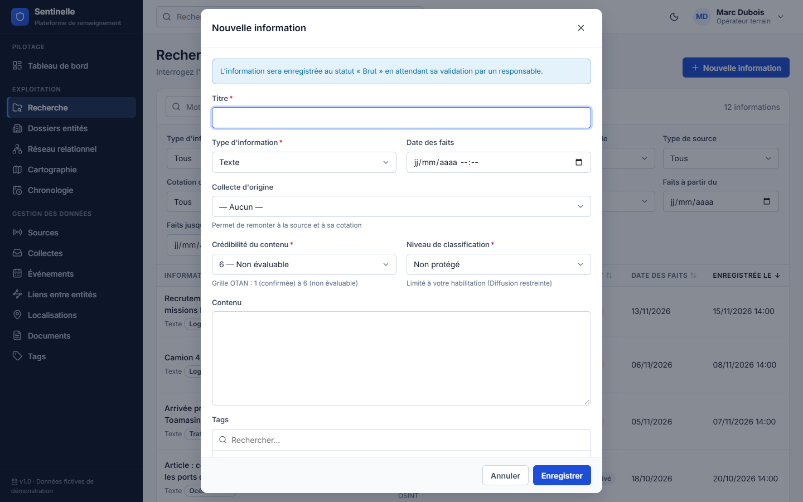

**Faire :** passer à l'onglet 2 → se connecter en **Opérateur terrain**.

1. **Montrer le menu** : pas de rubrique *Administration*.
2. Ouvrir **Recherche** : l'opérateur ne voit que **12 informations** (pas les *Confidentiel* ni le *Secret*).
3. Cliquer **Nouvelle information** et remplir :

| Champ | Valeur |
|---|---|
| Titre | `Déchargement nocturne suspect au quai 3` |
| Type | Texte |
| Date des faits | aujourd'hui, 02:30 |
| Collecte d'origine | une collecte *… — Informateur portuaire Mombasa (Entretien)* |
| Crédibilité | 3 — Possible |
| Classification | Diffusion restreinte |
| Contenu | `Trois conteneurs Kestrel déchargés hors horaires, sans agent des douanes.` |
| Tags | Trafic maritime, Urgent |
| Entités | Kestrel Logistique, Luc Ferrand |

4. **Enregistrer** → la fiche de l'information s'ouvre.

**Ce qu'on doit voir :**

- la liste *Classification* ne propose **que** « Non protégé » et « Diffusion restreinte » (habilitation de l'opérateur) ;
- il **n'y a pas** de champ *Statut* ; un bandeau indique que l'information sera enregistrée au statut **Brut** ;
- en validant le formulaire vide, les erreurs s'affichent sous chaque champ obligatoire.

**À dire :** « Le terrain alimente la base, mais ne peut ni sur-classifier ni valider : la validation est le travail du responsable. »

> Option : sur la fiche, cliquer **Ajouter** dans *Documents* pour joindre une photo ou un PDF : l'empreinte **SHA-256** est calculée et affichée (preuve d'intégrité).

---

### Acte 3 — Validation et cotation (2 min)

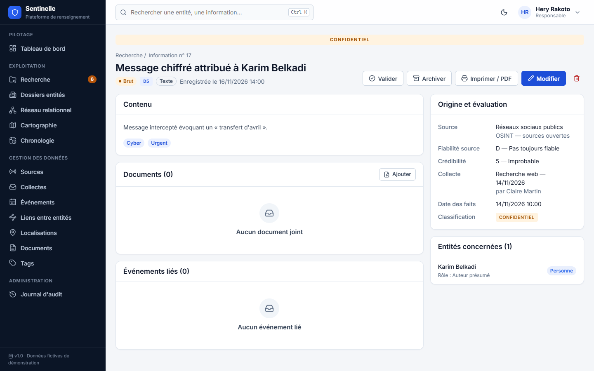

**Faire :** revenir à l'onglet 1 (Responsable). Le badge du menu *Recherche* est passé à **7**.

1. **Recherche** → filtre *Statut* = **Brut** → ouvrir l'information créée par l'opérateur.
2. Commenter la fiche : bandeau de classification en haut, badge de cotation (ex. **C3**), *Origine et évaluation* (source, fiabilité, collecte, auteur), entités concernées.
3. Cliquer **Valider** → le statut passe à **Validé**, le badge du menu redescend à 6.

**À dire :** « Le code **C3** se lit : source *assez fiable* (C), information *possible* (3). C'est la grille OTAN : l'analyste sait immédiatement quel crédit accorder à l'information. »

---

### Acte 4 — Recherche multicritères et export (2 min)

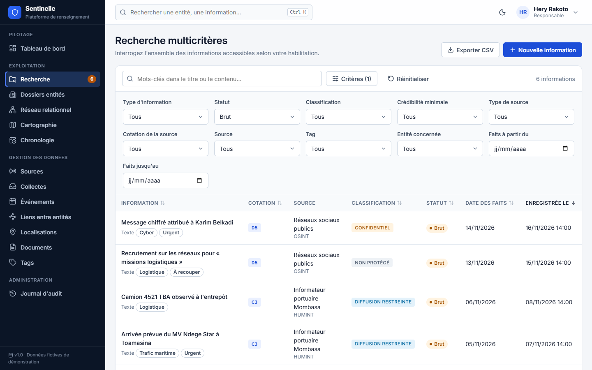

**Faire :**

1. Réinitialiser, puis combiner : *Tag* = **Trafic maritime**, *Cotation de la source* = **B**.
2. Trier en cliquant sur l'en-tête **Date des faits**.
3. Taper `conteneur` dans les mots-clés.
4. Cliquer **Exporter CSV** → le fichier s'ouvre dans Excel (séparateur « ; », accents corrects).

**À souligner :**

- les critères sont **dans l'adresse de la page** : on peut partager le lien d'une recherche ;
- l'export **respecte l'habilitation** et est lui-même **journalisé**.

**Bonus :** `Ctrl + K` ouvre la **recherche globale** (informations, entités, événements, sources, lieux) — taper `kestrel`.

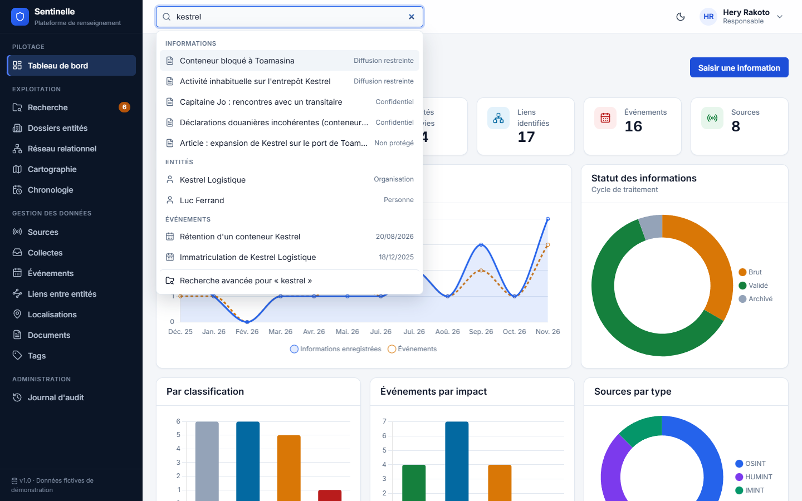

---

### Acte 5 — Dossier d'entité (2 min)

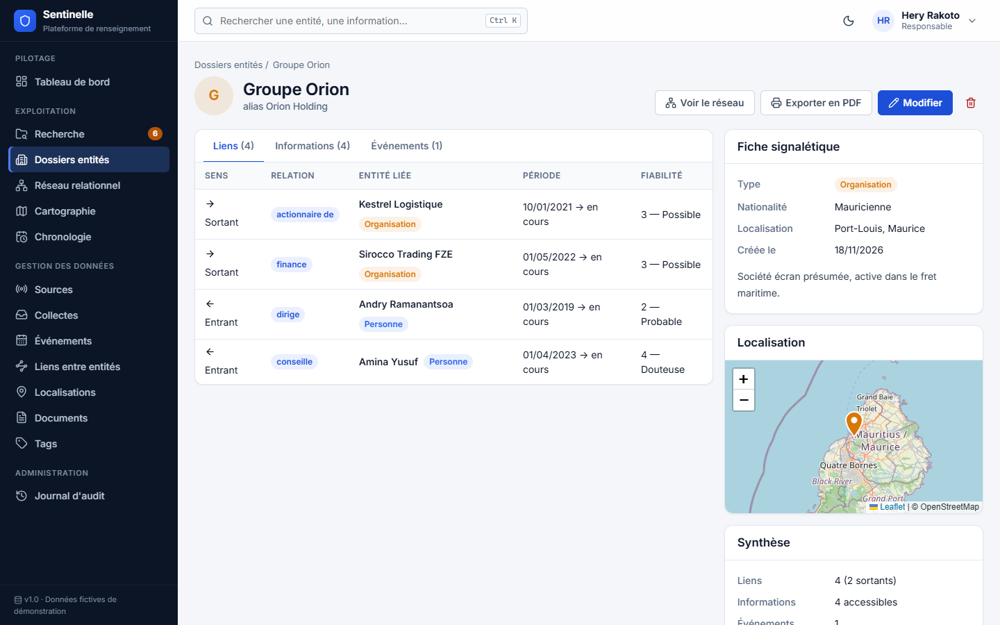

**Faire :** **Dossiers entités** → **Groupe Orion**.

**Ce qu'on voit :**

- la fiche signalétique (type, nationalité, localisation) et une mini-carte ;
- l'onglet **Liens** : sortants (*actionnaire de* Kestrel, *finance* Sirocco) et entrants (*dirige* : Andry Ramanantsoa, *conseille* : Amina Yusuf), avec leur période et leur fiabilité ;
- les onglets **Informations** et **Événements** rattachés.

**Faire :** cliquer **Exporter en PDF** → l'aperçu d'impression montre un dossier propre (sans menu), avec toutes les sections à la suite et la mention « édité le … par … ».

**À dire :** « Le dossier rassemble en un écran tout ce que l'on sait d'une cible ; il s'exporte en PDF pour un briefing. »

---

### Acte 6 — Réseau relationnel (2 min)

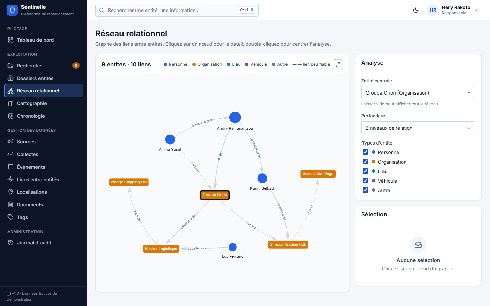

**Faire :** sur le dossier, cliquer **Voir le réseau** (ou menu *Réseau relationnel*, entité centrale = Groupe Orion).

1. Montrer la légende : couleur = type d'entité, forme carrée = organisation, **pointillés = lien peu fiable**, épaisseur = lien confirmé.
2. Passer la *Profondeur* de 2 à **3** → le réseau passe de 9 à 14 entités (apparaissent notamment le navire MV Ndege Star, son capitaine Joseph Otieno et Sophie Lambert, trésorière de Vega).
3. **Cliquer** sur *Sirocco Trading FZE* → panneau *Sélection* avec ses liens ; **double-cliquer** → le graphe se recentre sur elle.

**À dire :** « On visualise le circuit financier présumé : Orion → Sirocco (Dubaï) → Vega (Marseille). Les pointillés rappellent que certains liens restent à confirmer. »

---

### Acte 7 — Cartographie et chronologie (2 min)

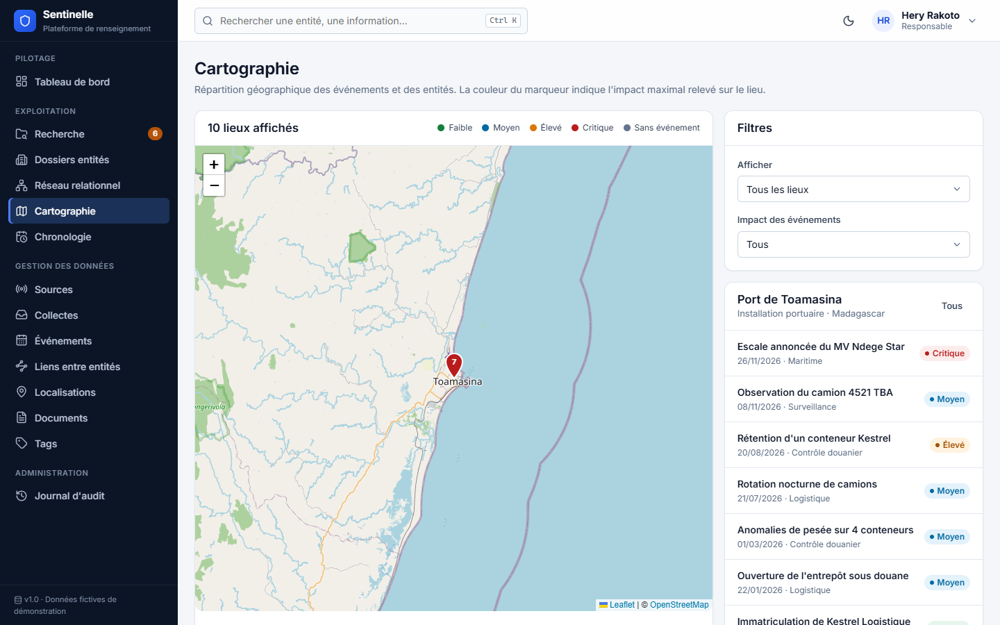

**Faire :** **Cartographie**.

1. Vue d'ensemble : Europe, Golfe, Afrique de l'Est, Madagascar. La **couleur** du marqueur = l'impact maximal ; le **chiffre** = nombre d'événements.
2. Cliquer sur **Port de Toamasina** (marqueur rouge, 7 événements) → la liste à droite montre l'**escale annoncée du MV Ndege Star — Critique**.
3. Filtre *Impact* = **Élevé** pour ne garder que les lieux sensibles.

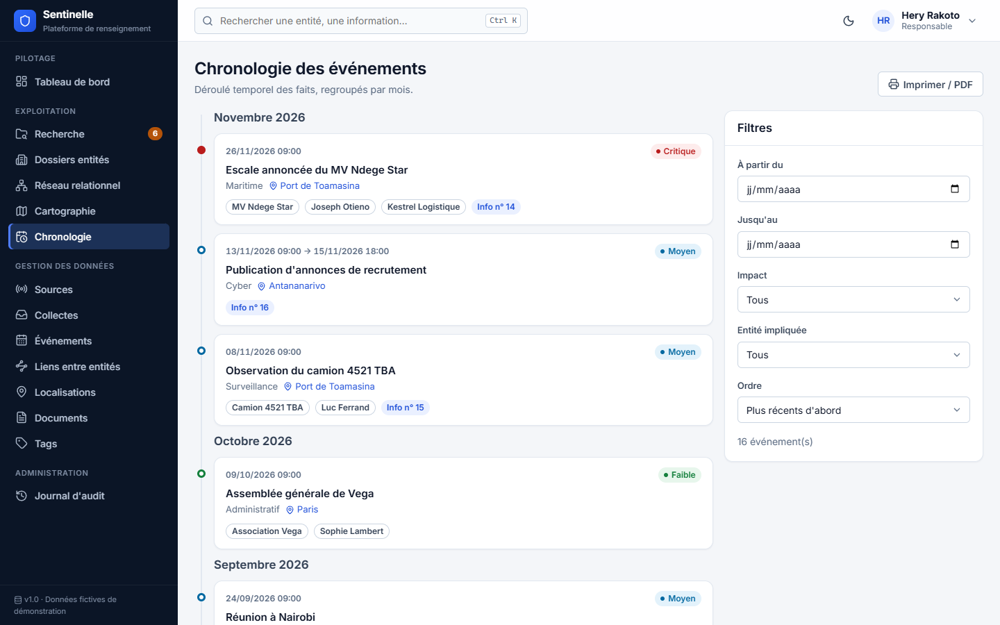

**Faire :** **Chronologie** → filtre *Entité impliquée* = **MV Ndege Star**.

**À dire :** « La chronologie montre l'escalade : transit à Djibouti, deux coupures du signal au large de Mahajanga, puis l'escale critique à venir. C'est l'élément qui justifie une décision. »

---

### Acte 8 — Cloisonnement par habilitation (2 min)

**Faire :**

1. Onglet 1 (Responsable) : `Ctrl + K` → taper `synthèse` → l'information **« Rapport de synthèse — réseau Orion »** apparaît (classée **Secret**).
2. Ouvrir un nouvel onglet → se connecter en **Analyste** (habilitation *Confidentiel*) → même recherche : **aucun résultat**. Le tableau de bord indique 17 informations au lieu de 18.
3. Dans l'onglet Opérateur : ouvrir **Utilisateurs** via l'adresse `/utilisateurs` → page **Accès refusé**.

**À dire :** « Le cloisonnement est appliqué par le serveur sur toutes les requêtes : liste, détail, recherche, documents, événements et exports. »

---

### Acte 9 — Traçabilité et administration (2 min)

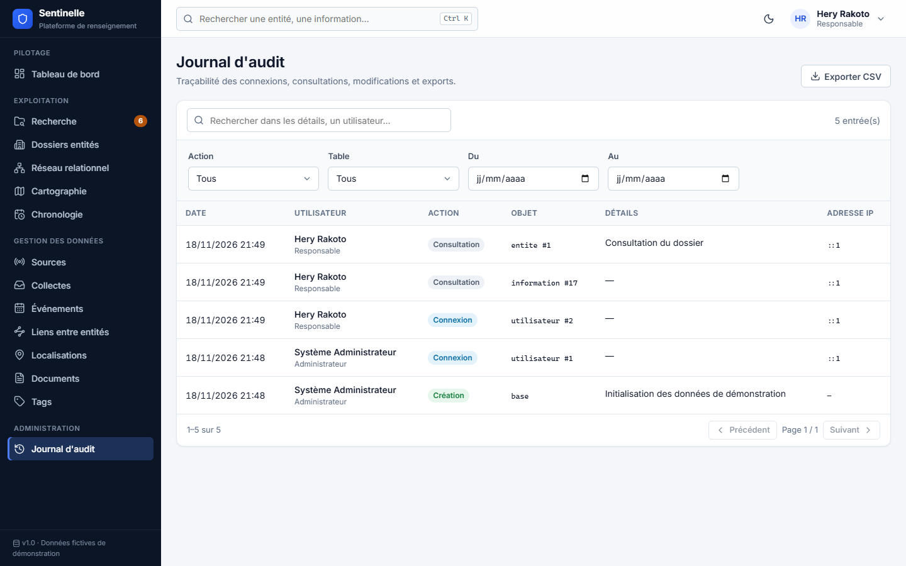

**Faire :** onglet Responsable → **Journal d'audit**.

- On retrouve **toutes les actions de la démo** : connexions, la création par l'opérateur, la validation, l'export CSV, les consultations de dossiers.
- Filtrer *Action* = **Export**, puis cliquer **Exporter CSV** (le journal lui-même est exportable).

**Faire (optionnel) :** se connecter en **Administrateur** → **Utilisateurs** :

- créer un compte (le mot de passe doit faire 10 caractères avec lettres et chiffres) ;
- passer un compte en **Suspendu** → la personne ne peut plus se connecter ;
- montrer qu'on ne peut ni supprimer son propre compte ni retirer ses propres droits d'administrateur.

**À dire :** « Qui a vu quoi, quand, depuis quelle adresse : c'est indispensable pour des données sensibles et pour détecter un usage anormal. »

---

### Acte 10 — Ergonomie et conclusion (1 min)

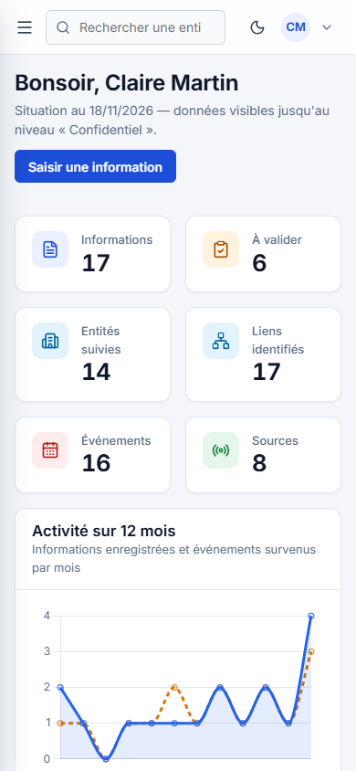

**Montrer rapidement :**

- l'icône 🌙 en haut à droite → **thème sombre** ;
- réduire la fenêtre → le menu se replie (affichage **mobile / tablette**) ;
- la navigation **au clavier** (`Tab`, `Entrée`, `Échap` ferme les fenêtres) ;
- **Mon profil** (menu utilisateur) → récapitulatif des droits et changement de mot de passe.

**Conclusion à dire :** « Sentinelle couvre tout le schéma : les 12 tables, les 4 profils d'utilisateurs et les 6 fonctions de l'interface de consultation — recherche multicritères, dossiers par entité, cartographie et réseau, chronologie, tableaux de bord et exports — avec une sécurité appliquée côté serveur et une traçabilité complète. »

---

## 7. Plan B : incidents possibles

| Incident | Réaction |
|---|---|
| La carte reste grise | Pas d'Internet : les fonds de carte viennent d'OpenStreetMap. Les marqueurs et la liste des lieux restent fonctionnels ; sinon montrer la capture de la section 7. |
| « Port 4000 occupé » au lancement | `DEMO_PORT=4001 npm run demo` puis ouvrir <http://localhost:4001>. |
| « PostgreSQL portable : démarrage impossible » | Un autre programme utilise le port 54330 : `DEMO_PG_PORT=54331 npm run demo`. |
| Données modifiées par une répétition | `Ctrl + C` puis `npm run demo -- --reset`. |
| Session expirée (après 8 h) | Se reconnecter : retour automatique à la page de connexion. |
| Plus rien ne marche | Présenter avec les **captures d'écran** de ce guide (dossier `docs/images/`). |

---

## 8. Questions probables et réponses

**Pourquoi PostgreSQL et pas MySQL ?**
Robustesse, respect strict des contraintes d'intégrité, recherche insensible à la casse native (`ILIKE`), type JSON (`autres_attributs`), et c'est le SGBD retenu par le groupe. Grâce à Prisma, changer de SGBD ne demanderait qu'une ligne de configuration.

**À quoi sert Prisma ?**
C'est l'ORM : le modèle est décrit une seule fois dans `schema.prisma`, les **migrations SQL** sont générées et versionnées dans Git (chaque membre applique les mêmes), et toutes les requêtes sont **paramétrées**, ce qui empêche l'injection SQL.

**Comment sont stockés les mots de passe ?**
Jamais en clair : hachés avec **bcrypt** (12 tours). À la connexion, on compare les empreintes. Le message d'erreur est volontairement le même que le compte existe ou non. Les tentatives sont limitées (20 par quart d'heure).

**Comment est appliquée la classification ?**
Côté serveur, chaque requête sur les informations ajoute la condition `niveau_classification ≤ habilitation de l'utilisateur`. La même règle s'applique aux documents et événements liés, à la recherche globale, au tableau de bord et aux exports. Un utilisateur ne peut pas non plus **créer** une information plus classifiée que son habilitation.

**Comment garantir qu'un document n'a pas été modifié ?**
Son empreinte **SHA-256** est calculée au dépôt et affichée. Le fichier ne peut plus être remplacé (seule sa description est modifiable). Recalculer l'empreinte du fichier téléchargé permet de vérifier son intégrité.

**Que se passe-t-il si on supprime une source utilisée ?**
La base refuse (contrainte `RESTRICT`) et l'application affiche « Suppression impossible : cet élément est encore utilisé ». À l'inverse, supprimer une entité supprime ses liens (cascade), car un lien sans ses deux extrémités n'a pas de sens.

**Qu'est-ce que la cotation « B2 » ?**
La grille OTAN (dite de l'Amirauté) évalue séparément la **source** (A totalement fiable → F inconnue) et l'**information** (1 confirmée → 6 non évaluable). B2 = source habituellement fiable, information probable.

**L'application est-elle accessible ?**
Elle suit les recommandations **WCAG 2.1 AA** : contrastes suffisants, navigation au clavier, focus visible, libellés sur tous les champs, messages d'erreur explicites, fenêtres modales accessibles, lien d'évitement, thème sombre, affichage adapté au mobile.

**Comment un nouveau membre installe-t-il le projet ?**
`git clone`, puis `npm run setup` : le script installe tout, propose d'utiliser un PostgreSQL existant ou un **PostgreSQL portable** (aucune installation), crée la base en UTF-8, les tables et les données de démo. Ensuite `npm run dev`.

**Limites et évolutions possibles ?**
Recherche plein texte avancée (index `tsvector` PostgreSQL), import automatique de flux OSINT, double authentification, chiffrement des documents au repos, notifications (nouvelle information urgente), tests automatisés de bout en bout, déploiement conteneurisé.

---

## 9. Annexes

### Commandes utiles

| Commande | Effet |
|---|---|
| `npm run demo` | Démo autonome (PostgreSQL portable + données fictives) sur <http://localhost:4000> |
| `npm run demo -- --reset` | Idem avec des données neuves |
| `npm run setup` | Installation pour le développement |
| `npm run dev` | Développement : <http://localhost:5173> |
| `npm run db:studio` | Explorer les tables dans Prisma Studio |

### Matrice des droits

| Données | Admin | Responsable | Analyste | Opérateur | Décideur |
|---|:-:|:-:|:-:|:-:|:-:|
| Lecture (selon habilitation) | ✓ | ✓ | ✓ | ✓ | ✓ |
| Saisie sources / collectes / informations / documents | ✓ | ✓ | ✓ | ✓ | — |
| Saisie entités / liens / lieux / événements / tags | ✓ | ✓ | ✓ | — | — |
| Modification | ✓ | ✓ | ✓ | — | — |
| Validation / archivage / suppression | ✓ | ✓ | — | — | — |
| Journal d'audit | ✓ | ✓ | — | — | — |
| Exports | ✓ | ✓ | ✓ | — | ✓ |
| Gestion des utilisateurs | ✓ | — | — | — | — |

### Correspondance avec le schéma conceptuel

| Élément du schéma | Où le montrer |
|---|---|
| SOURCE, COLLECTE | Menus *Sources*, *Collectes* ; bloc *Origine et évaluation* d'une information |
| INFORMATION, TAG, INFO_TAG | *Recherche*, fiche d'une information |
| DOCUMENT | Fiche d'une information, menu *Documents* |
| ENTITE, LIEN_ENTRE_ENTITES | *Dossiers entités*, *Réseau relationnel*, *Liens entre entités* |
| LOCALISATION, EVENEMENT | *Cartographie*, *Chronologie*, *Événements* |
| UTILISATEUR | *Utilisateurs* (admin), *Mon profil* |
| HISTORIQUE_ACTION | *Journal d'audit* |
| Utilisateurs selon habilitation | Comptes Analyste / Responsable / Décideur / Opérateur terrain |
| Interface de consultation (6 fonctions) | Actes 4 à 7 et tableau de bord |
